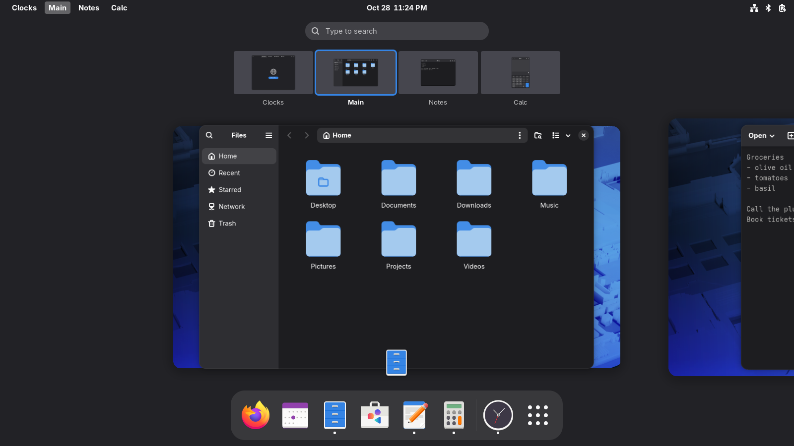
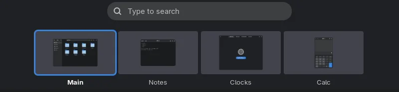
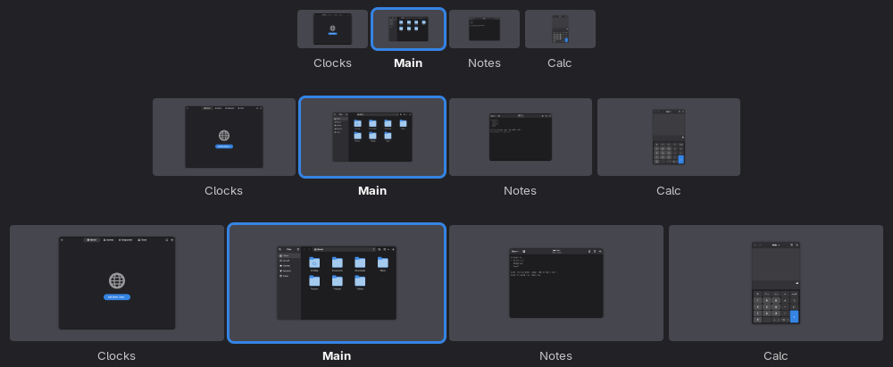

# Better Workspace Thumbnails

Make the workspace thumbnails in the Activities overview easier to use. GNOME
shows them small and unlabeled, so with several workspaces you end up
squinting at tiny window previews. This extension makes them larger, puts
each workspace's name under its thumbnail, and lets you drag thumbnails to
change the order of your workspaces.



## Features

- **Larger thumbnails.** Choose a size from GNOME's own up to four times as
  large. The default is twice GNOME's size.
- **Names under thumbnails.** Each thumbnail shows its workspace's name, and
  the current workspace's name is in bold.
- **Reorder workspaces.** Point at a thumbnail and a small grip appears on
  its top edge. Drag it along the strip and the other thumbnails slide aside
  to show where it will land. Let go outside the strip to cancel.
- **Drag the whole thumbnail (optional).** Turn this on in the settings to
  drag a thumbnail from anywhere on it, with no grip.
- **Everything else stays the same.** Clicking a thumbnail still switches to
  it, and you can still drop windows onto thumbnails.



## Requirements

GNOME Shell 50.

## Install

1. Download `better-workspace-thumbnails@idogr.shell-extension.zip` from the
   [latest release](https://github.com/idogrf/better-workspace-thumbnails/releases/latest).
2. Install it:

   ```bash
   gnome-extensions install --force ~/Downloads/better-workspace-thumbnails@idogr.shell-extension.zip
   ```

3. Log out and log back in. GNOME only picks up newly installed extensions at
   login.
4. Turn it on in the **Extensions** app, or with:

   ```bash
   gnome-extensions enable better-workspace-thumbnails@idogr
   ```

To update, repeat steps 1 to 3 with the new release.

## Name your workspaces

The names under the thumbnails are the ones GNOME already stores for your
workspaces. The easiest way to set them is the
[Space Bar](https://extensions.gnome.org/extension/5090/space-bar/)
extension, which lets you rename workspaces from the top bar. Without it, set
them from a terminal, one name per workspace in order:

```bash
gsettings set org.gnome.desktop.wm.preferences workspace-names "['Main', 'Mail', 'Code']"
```

Workspaces without a name show "Workspace 1", "Workspace 2" and so on.

**If you reorder workspaces, use Space Bar.** GNOME remembers names by
position, not by workspace. Space Bar moves each name along with its
workspace when you reorder; without it, a moved workspace takes the name of
the position it lands in.

## Settings

Open the settings from the gear icon in the **Extensions** app, or with
`gnome-extensions prefs better-workspace-thumbnails@idogr`.

- **Thumbnail size:** from 1x (GNOME's own size) to 4x. Changes apply right
  away, even with the overview open. With many workspaces, the width of the
  screen may stop the thumbnails from growing as large as the setting.
- **Drag the whole thumbnail:** drag a thumbnail from anywhere on it to
  reorder, instead of by the grip. A click still switches workspace, but you
  can no longer drag a window out of a thumbnail.



## Known limitations

- **Turning the extension on while the overview is open** takes effect the
  next time you open the overview.
- **The empty workspace at the end** (with dynamic workspaces) has no name
  and can't be dragged.

## Uninstall

```bash
gnome-extensions uninstall better-workspace-thumbnails@idogr
dconf reset -f /org/gnome/shell/extensions/better-workspace-thumbnails/
```

The second line removes its saved settings.

## Build from source

```bash
git clone https://github.com/idogrf/better-workspace-thumbnails.git
cd better-workspace-thumbnails
sh pack.sh
```

This writes `dist/better-workspace-thumbnails@idogr.shell-extension.zip`.
Install it as in step 2 above.

## License

GPL-2.0-or-later. See [LICENSE](LICENSE).
